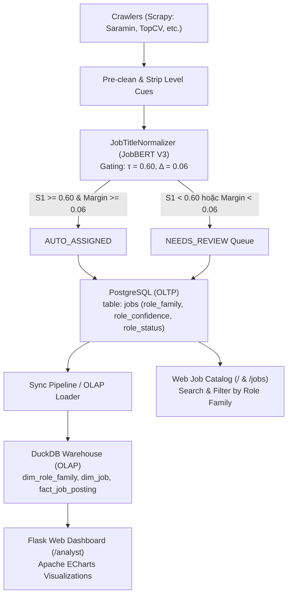

# IT Skill Insights (v0.1)

**Turn IT job postings into a practical, data-driven map of market-demanded skills.**

IT Skill Insights is an end-to-end data platform for crawling, staging, standardizing, and analyzing IT job postings. It extracts technical skills and explores employer demand patterns across 16 standardized IT role families and seniority levels.

> **Release Version:** `v0.1`  
> **Key Milestones:** Automated Role Normalization via `TechWolf/JobBERT-v3`, Dimensional Modeling in DuckDB OLAP, and Modern Interactive Analyst Dashboard with Apache ECharts.

---

## 🚀 Key Features in v0.1

### 1. JobBERT V3 Semantic Role Normalization (Architecture: Crawl $\rightarrow$ JobTitleNormalizer $\rightarrow$ OLTP $\rightarrow$ OLAP)
- **1024-Dimensional Semantic Vectors**: Uses `TechWolf/JobBERT-v3` anchor branch embeddings to represent raw IT job titles.
- **Level-Cue Stripping Preprocessor**: Removes noisy seniority prefixes (`Senior`, `Intern`, `Chuyên viên`, `Lead`, `Fresher`) before computing vector representations, preventing title level cues from distorting role taxonomy.
- **Confidence & Margin Gating ($\tau = 0.60, \Delta = 0.06$)**:
  - `AUTO_ASSIGNED`: Automatically normalizes high-certainty jobs ($S_1 \ge 0.60$ and $\Delta \ge 0.06$).
  - `AMBIGUOUS_REVIEW`: Flags hybrid titles (e.g., Fullstack vs Backend, BA vs QA) with top-2 ranked candidates for 1-click human review.
  - `LOW_CONFIDENCE_REVIEW`: Routes novel or out-of-vocabulary titles safely to human review.
- **Passes Shadow Promotion Gate**: Reduces false merges from **61.9%** (Ruleset v0.1 baseline) down to **4.0%**, while increasing automated classification coverage from **24.1%** to **57.5%** on the held-out benchmark.

### 2. Dual Database Architecture (OLTP & OLAP)
- **OLTP (PostgreSQL 16)**:
  - Serves as the single source of truth for job ingestion, source permissions, and job search.
  - Indexed by `role_family` and `role_decision_status` for sub-2ms job searches.
- **OLAP Warehouse (DuckDB 2.0)**:
  - Multi-dimensional Star Schema: `dim_role_family` (16 role groups), `dim_job`, `dim_seniority`, `dim_skill`, and `fact_job_posting`.
  - Native Quack protocol support over port `9494`.

### 3. Modern Interactive Analyst Dashboard (Light Theme + Apache ECharts)
- **KPI Metrics**: Total analyzed jobs, active IT role families, identified skills, and automation accuracy rate.
- **ECharts Interactive Visualizations**:
  - **Horizontal Bar Chart**: Top role family distributions.
  - **Donut Chart**: Seniority level proportions.
  - **Skill $\times$ Level Heatmap**: Interactive matrix visualizing demand intensity across career stages (Intern $\rightarrow$ Fresher $\rightarrow$ Senior $\rightarrow$ Leader).
- **Core Skill Explorers**: Detailed tag clouds and level breakdowns per role family.
- **Track Slicing**: Dynamic tab switching (`All Tracks`, `Track IT`, `Track Data`) with instantaneous updates.

---

## 🏗️ System Architecture & Data Flow



---

## 🛠️ Technology Stack

| Component | Technology / Library |
|---|---|
| **Language & Runtime** | Python 3.11 |
| **NLP & Deep Learning** | `TechWolf/JobBERT-v3`, PyTorch, Sentence-Transformers, HuggingFace Hub |
| **Operational DB (OLTP)** | PostgreSQL 16 (Alpine) |
| **Analytical DB (OLAP)** | DuckDB 2.0.0 (Quack Remote Engine) |
| **Web & API Framework** | Flask, Jinja2 |
| **Frontend Visualization** | Apache ECharts 5.5, Modern Vanilla JS, CSS3 Light Theme |
| **Scraping & Pipelines** | Scrapy, Apache Airflow 2.9 |
| **Containerization** | Docker, Docker Compose |

---

## 📂 Repository Structure

```text
├── dags/                       # Airflow DAG definitions for automated crawl & transform
├── data/                       # Ground-truth benchmarks, evaluation reports, and prototypes
│   ├── role_family_prototypes_v0_1.json    # 16 standard IT families with prototype anchors
│   ├── title_benchmark_v0_1.json           # 87-title multi-lingual ground truth benchmark
│   ├── shadow_gate_evaluation_report.json  # Shadow promotion gate evaluation results
│   └── shadow_deployment_report.md         # A/B testing report: JobBERT vs Ruleset v0.1
├── database/
│   ├── olap/                   # DuckDB schema migrations (001_core, 003_dim_role_family)
│   └── postgres/               # PostgreSQL migrations (001-007: schema, shadow, role normalization)
├── scraper/                    # Scrapy spiders and ingestion pipelines
├── scripts/                    # Automation and evaluation scripts
│   ├── map_titles_to_role_families.py      # JobBERT semantic title normalizer CLI
│   ├── run_shadow_classification.py        # Shadow classification engine
│   ├── evaluate_shadow_vs_ruleset.py       # Promotion gate verification runner
│   ├── backfill_oltp_job_role_families.py  # OLTP backfill script
│   └── sync_oltp_roles_to_olap.py          # OLTP -> OLAP DuckDB sync script
└── web/                        # Web platform and Analyst Dashboard
    ├── app.py                  # Flask application entry point
    ├── analyst_service.py      # DuckDB OLAP analytical query service
    ├── static/css/             # Stylesheets (Light Theme)
    ├── static/js/analyst.js    # Interactive ECharts rendering logic
    └── templates/              # HTML templates (index, job_detail, analyst)
```

---

## ⚡ Quick Start

### 1. Prerequisites
- Docker & Docker Desktop
- Python 3.11+
- Git

### 2. Configure Environment
Copy the example environment settings to `.env`:
```bash
JOB_POSTGRES_HOST=127.0.0.1
JOB_POSTGRES_PORT=5434
JOB_POSTGRES_DB=it_job_platform
JOB_POSTGRES_USER=job_pipeline
JOB_POSTGRES_PASSWORD=your_secure_password
JOB_WEB_DB_USER=job_web_reader
JOB_WEB_DB_PASSWORD=your_web_password
JOB_OLAP_TOKEN=your_olap_token
```

### 3. Launch Services with Docker Compose
```bash
docker compose up -d job-postgres job-olap web
```

### 4. Run Semantic Normalization & Sync (Optional Manual Run)
```bash
# Normalize all jobs in PostgreSQL using JobBERT V3
python scripts/backfill_oltp_job_role_families.py

# Sync normalized roles to DuckDB OLAP Warehouse
python scripts/sync_oltp_roles_to_olap.py
```

### 5. Access the Platform
- **Job Catalog**: [http://localhost:5000](http://localhost:5000)
- **Analyst Pro Dashboard**: [http://localhost:5000/analyst](http://localhost:5000/analyst)

---

## 📈 Benchmark & Gate Evaluation (JobBERT V3 vs Ruleset v0.1)

| Metric | Ruleset v0.1 (Baseline) | JobBERT V3 (Gated: $\tau=0.60, \Delta=0.06$) | Impact |
|---|:---:|:---:|:---:|
| **Auto-Classification Rate** | 24.1% (21/87) | **57.5% (50/87)** | **+138% Improvement** |
| **False Merges (Gộp nhầm)** | 13 | **2** | **-84.6% Reduction** |
| **False Merge Rate** | 61.9% | **4.0%** | **Safe for Analytics** |
| **Human Review Needed** | 66 jobs | **37 jobs** | Reduced manual workload |
| **Promotion Gate Result** | — | **`PROMOTE_APPROVED`** | Passed |

---

## 📄 License & Attribution
- Project developed under IT Skill Insights.
- Uses pretrained weights from [`TechWolf/JobBERT-v3`](https://huggingface.co/TechWolf/JobBERT-v3) (FEAST 2021).
