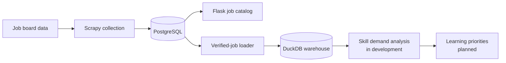

# IT Skill Insights

**Turn IT job postings into a practical map of skills to learn.**

IT Skill Insights is a data platform for collecting and organizing IT job postings, then studying which skills employers ask for by role, seniority, and time period. The long-term goal is to use those findings to help people choose what to learn and in what order.

> **Project status:** In active development. The repository has job collection, transformation, a job catalog, and an analytical warehouse foundation. Skill-demand reports and learning roadmaps are not yet implemented end to end.

## What the project aims to answer

- Which technical and professional skills appear most often in job postings?
- How does skill demand differ between roles and seniority levels?
- Which skills are becoming more or less common over time?
- What skills could someone prioritize when planning their studies?

The analysis is intended to show its sample size, data coverage, and supporting job-description evidence. Job-ad frequency is a signal of employer demand; it is not a guarantee of hiring success.

## Current capabilities

- Scrapy spiders and transformation code for job listings, job details, titles, and skills.
- PostgreSQL schemas for job sources, postings, crawl activity, and staged job candidates.
- A Flask catalog for browsing and filtering available jobs and opening job details.
- A DuckDB warehouse schema with dimensions for seniority and skills, analysis/evidence facts, and a monthly skill-demand mart.
- A verified-job loader that currently transfers job metadata and source-coverage data from PostgreSQL to DuckDB.

The warehouse schema is ahead of the analysis workflow: skill-analysis facts and monthly skill-demand results are not populated yet. Building reliable skill normalization, evidence-backed analysis, and learning priorities is the next product focus.

## Data flow



Apache Airflow DAGs are included for pipeline orchestration. The crawler, database, and web application run as Docker Compose services.

## Technology

| Area | Tools |
|---|---|
| Collection | Scrapy, Python |
| Operational data | PostgreSQL |
| Analytics warehouse | DuckDB |
| Orchestration | Apache Airflow |
| Job catalog | Flask |
| Local environment | Docker Compose |

## Run the job catalog locally

### Requirements

- Docker Desktop or Docker Engine with the Compose plugin
- Git

### Setup

```bash
git clone https://github.com/mduy2k5/IT-Skill-Insights.git
cd IT-Skill-Insights
```

Create a local environment file and set unique development values for the database passwords and OLAP token:

```powershell
Copy-Item .env.example .env
```

On macOS or Linux, use `cp .env.example .env` instead. Edit `.env` before starting the services. The file is ignored by Git; do not commit it.

Start PostgreSQL and the Flask catalog:

```bash
docker compose up --build -d job-postgres web
```

Open the catalog at [http://localhost:5000](http://localhost:5000). A fresh database starts without job data; load or ingest job records before expecting listings to appear.

## Optional: start the full pipeline and warehouse

Apply the initial DuckDB schema **before** starting the DuckDB server:

```bash
docker compose --profile olap-tools run --rm --no-deps job-olap-migrate
docker compose up --build -d
```

The full Compose stack also starts the crawler and Airflow services. Airflow is available at [http://localhost:8088](http://localhost:8088); the development account configured in Compose is `airflow` / `airflow`.

To preview a verified-job load before applying it, use the configured source code for your data. For example:

```bash
docker compose --profile olap-tools run --build --rm job-olap-loader --source-code saramin --project-track data --dry-run
```

Replace `--source-code saramin` with the source identifier present in your database. To apply the load, replace `--dry-run` with `--apply`. This loader currently loads verified job metadata and source-coverage data; it does not yet generate skill-demand analytics.

See [database/olap/README.md](database/olap/README.md) for warehouse setup and loading details.

## Repository layout

```text
database/
  postgres/              PostgreSQL schemas and migrations
  olap/                  DuckDB schema, loader, and warehouse notes
dags/                    Airflow DAGs
scraper/job_crawler/     Scrapy spiders and transformation code
specs/                   Product and implementation specifications
web/                     Flask application, templates, CSS, and JavaScript
docker-compose.yml        Local services
```

## Planned analysis work

1. Build a maintainable skill taxonomy with aliases and versioned mappings.
2. Extract skills from job descriptions and retain evidence for each match.
3. Compare skill demand by role, seniority, source, and month, with clear denominators and coverage.
4. Turn the analysis into transparent learning priorities and role-based study paths.

## Data and collection notes

- Skill statistics should report how many eligible jobs were analyzed and how much source data is missing or unclassified.
- Keep source labels and job records traceable so an analysis can be checked against the original posting.
- Respect each source's access limits and configure collection conservatively.
- Use `.env.example` as a template; `.env` contains local credentials and must stay private.

## License

No license has been added yet. Ask the repository owner before reusing or redistributing the project.
