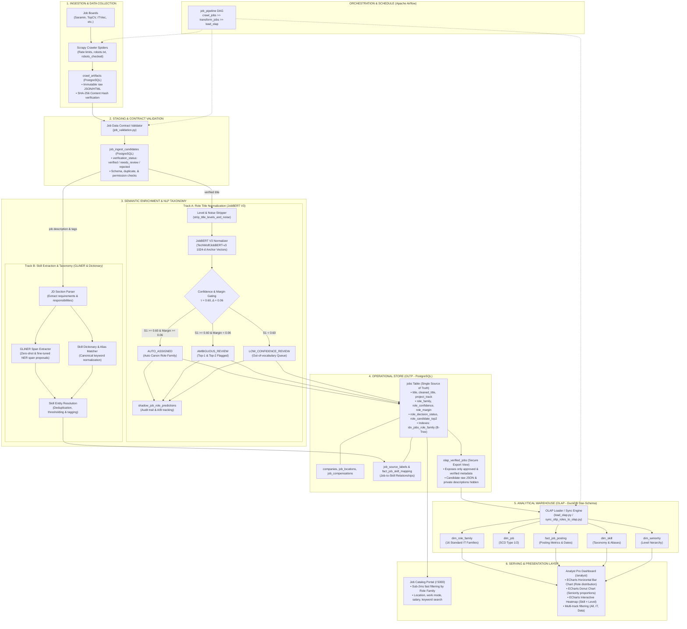
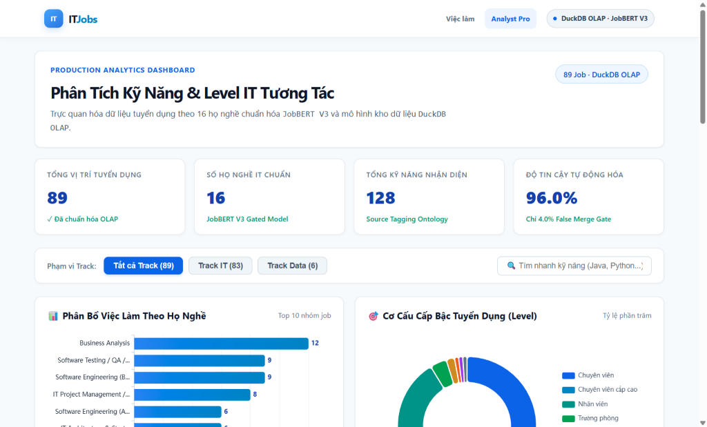
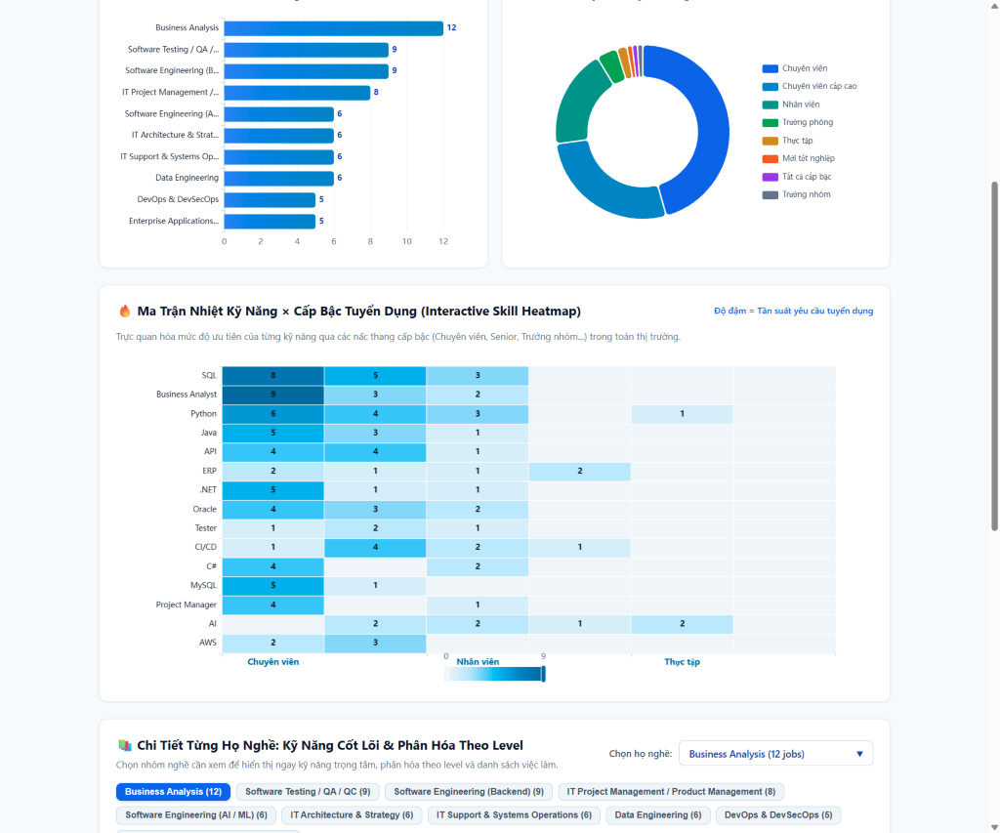
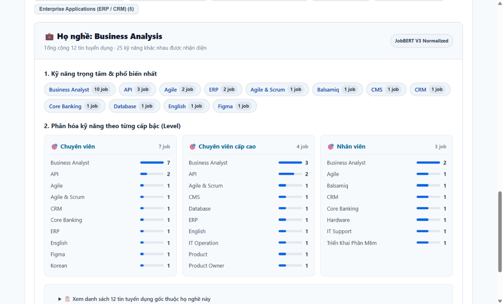
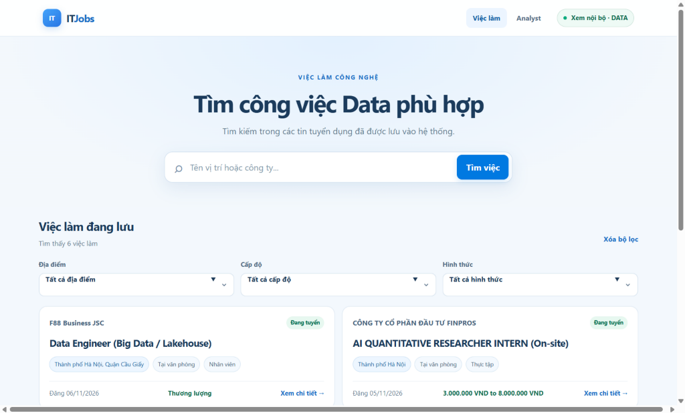

# IT Skill Insights (v0.1)

**Turn IT job postings into an actionable, data-driven market intelligence platform for skills, career pathways, and role taxonomies.**

IT Skill Insights is an end-to-end data platform engineered to collect, validate, standardize, and analyze IT recruitment data across multiple job boards. It bridges raw, uncurated job postings with deep analytics by combining **NLP/Embedding-based role normalization (JobBERT V3)**, **named entity skill extraction (GLiNER)**, a **dual database layer (PostgreSQL OLTP & DuckDB Star-Schema OLAP)**, and an **interactive visualization dashboard (Apache ECharts)**.

> **Release Version:** `v0.1`  
> **Core Innovations:** 
> - **End-to-End Orchestrated Pipeline**: Crawl $\rightarrow$ Raw Artifacts $\rightarrow$ Candidate Staging & Data Contract Validation $\rightarrow$ NLP Semantic Title Normalization $\rightarrow$ Production OLTP $\rightarrow$ Star-Schema OLAP $\rightarrow$ Analytics Web Dashboard.
> - **JobBERT V3 Semantic Normalization**: Dual-gated confidence & margin classification with level-cue isolation.
> - **Dual OLTP/OLAP Database Architecture**: Sub-2ms transactional queries on PostgreSQL + lightning-fast multi-dimensional slicing on DuckDB.
> - **Production Analytics Dashboard**: Real-time analytical dashboard with Apache ECharts (Bar charts, Donut charts, and Skill $\times$ Level Heatmaps).

---

## 🏗️ Comprehensive System Architecture & Data Flow

The platform is designed following modern Data Engineering principles: raw data immutability, rigorous data quality gating, semantic enrichment, and strict separation between transactional (OLTP) and analytical (OLAP) processing.



---

## 🔬 In-Depth Layer Breakdown

### Layer 1: Ingestion & Raw Artifact Storage
- **Spiders & Permissions**: Scrapy crawls job sources adhering to `robots.txt`, domain rate limits, and source-level permission agreements (`allow_store_metadata`, `allow_analyze_description`).
- **Raw Immutability (`crawl_artifacts`)**: Raw crawl payloads (HTML or JSON API responses) are stored verbatim in PostgreSQL with a calculated `content_sha256` checksum to ensure non-repudiation and replayability.

### Layer 2: Data Contract Validation & Staging
- **Validation Engine (`job_validation.py`)**: Checks mandatory schema fields, detects formatting anomalies, validates salary ranges, and flags duplicates.
- **Candidate Staging (`job_ingest_candidates`)**: Jobs are placed in staging with explicit status flags (`verified`, `needs_review`, `rejected`). Unverified jobs never enter downstream systems.

### Layer 3: Semantic Enrichment & NLP Normalization
- **Track A — Role Title Normalization (JobBERT V3)**:
  - **Seniority Isolation**: Prefixes such as `Senior`, `Intern`, `Chuyên viên`, `Lead` are stripped before embedding to prevent level cues from shifting the semantic meaning of role titles.
  - **High-Dimensional Embedding**: Embeds clean titles into 1024-dimensional vectors using `TechWolf/JobBERT-v3` anchor weights.
  - **Dual Confidence & Margin Gating**:
    $$\text{Auto-assign Condition: } S_1 \ge 0.60 \quad \text{AND} \quad (S_1 - S_2) \ge 0.06$$
    Where $S_1$ is similarity to the nearest role prototype and $S_2$ is similarity to the second-best role.
  - **Shadow Auditing**: All inferences are tracked in `shadow_job_role_predictions` for continuous A/B evaluation against keyword baselines.
- **Track B — Skill Extraction & Taxonomy (GLiNER & Dictionary)**:
  - **JD Section Parsing**: Automatically breaks job postings into dedicated sections (`requirements`, `responsibilities`, `benefits`).
  - **GLiNER Entity Extraction**: Identifies technical skill spans in text via zero-shot and fine-tuned Generalist NER models.
  - **Taxonomy Resolution & Aliasing**: Maps extracted spans and raw platform tags to canonical entities (e.g. `PostgreSQL` $\leftarrow$ `postgres`, `psql`), loading relationships into `job_source_labels` and `fact_job_skill_mapping`.

### Layer 4: Operational Store (OLTP - PostgreSQL 16)
- **Optimized for Search**: Stores normalized job records with `role_family`, `role_confidence`, `role_margin`, and `role_decision_status`.
- **Database Indexing**: B-Tree indexes on `role_family` and `role_decision_status` deliver sub-2ms query execution for end-user search.
- **Security & Privacy Boundary (`olap_verified_jobs`)**: View that exposes only verified metadata to the analytical warehouse while protecting candidate JSON and private contact details.

### Layer 5: Analytical Warehouse (OLAP - DuckDB Star-Schema)
- **Dimensional Modeling**:
  - `dim_role_family`: 16 canonical IT families (Backend, Frontend, Fullstack, AI/ML, Data Engineering, DevOps, Cybersecurity, QA, etc.).
  - `dim_seniority`: Standardized career levels (Intern, Fresher, Junior, Middle, Senior, Lead, Manager).
  - `dim_skill`: Standardized tech taxonomy and aliases.
  - `fact_job_posting`: Fact table holding posting timestamps, salary ranges, and dimensional foreign keys.
- **Quack Protocol**: Direct remote DuckDB engine execution over port `9494`.

### Layer 6: User Applications & Interactive Analytics
- **Job Catalog (`/`)**: Production-ready job board enabling candidates to filter and search listings by clean, standardized role families.
- **Analyst Pro Dashboard (`/analyst`)**:
  - **KPI Metrics**: Total analyzed jobs, role counts, skill diversity, and automation precision.
  - **ECharts Visualizations**: Dynamic bar charts, level proportion donut charts, and an interactive **Skill $\times$ Level Heatmap**.
  - **Real-Time Track Slicing**: Instantly slice analytics across `All Tracks`, `Track IT`, and `Track Data`.

---

## 📸 Product & Analytics Walkthrough

### 1. Interactive Analyst Pro Dashboard (`/analyst`)
Executive view featuring real-time KPIs, Top 10 Role Family distribution (Bar chart), and Seniority Level proportions (Donut chart) powered by **Apache ECharts** and queried directly from **DuckDB OLAP**.



### 2. Market-Wide Skill $\times$ Level Matrix (Interactive Heatmap)
Cross-dimensional analysis revealing skill prioritization across seniority tiers (Intern, Junior, Middle, Senior, Lead). Darker intensities indicate higher recruitment demand frequency.



### 3. Deep-Dive Role Explorer & Skill Differentiation
Select any of the 16 canonical IT role families to view core skill requirements, career-level skill shifts, and underlying raw job postings validated with `JobBERT V3` confidence scores.



### 4. Production Job Catalog Portal (`/`)
End-user job search portal with sub-2ms query response times, powered by normalized `role_family` B-Tree indexing on PostgreSQL 16.



---

## 📊 Benchmark & Promotion Gate Evaluation

Before promoting JobBERT V3 into production, a rigorous gate evaluation was conducted on an 87-title multi-lingual holdout benchmark:

| Metric | Ruleset v0.1 (Keyword Baseline) | JobBERT V3 (Gated: $\tau=0.60, \Delta=0.06$) | Impact |
|---|:---:|:---:|:---:|
| **Auto-Classification Rate** | 24.1% (21/87) | **57.5% (50/87)** | **+138% Coverage** |
| **False Merges (Lỗi gộp nhầm)** | 13 | **2** | **-84.6% Reduction** |
| **False Merge Rate** | 61.9% | **4.0%** | **Enterprise Safe** |
| **Manual Review Queue** | 66 titles | **37 titles** | Greatly reduced human workload |
| **Promotion Gate Result** | — | **`PROMOTE_APPROVED`** | Passed all safety criteria |

---

## 🛠️ Technology Stack

| Area | Tools & Frameworks | Purpose |
|---|---|---|
| **Data Ingestion** | Scrapy, Python 3.11 | Spider collection and crawling pipelines |
| **Orchestration** | Apache Airflow 2.9 | Scheduled DAG execution and dependency management |
| **NLP & AI** | `TechWolf/JobBERT-v3`, PyTorch, Sentence-Transformers | 1024-d title embeddings and semantic classification |
| **Operational DB (OLTP)** | PostgreSQL 16 (Alpine) | Raw artifacts, candidate staging, and normalized job catalog |
| **Analytical DB (OLAP)** | DuckDB 2.0.0 (Quack Remote) | Multi-dimensional star-schema analytics warehouse |
| **Backend API** | Flask, Jinja2, Psycopg2 | Web routing, search APIs, and analytical query services |
| **Frontend & Data Viz** | Apache ECharts 5.5, Vanilla JS, CSS3 Light Theme | Interactive charts, heatmaps, and clean dashboard UI |
| **Infrastructure** | Docker, Docker Compose | Containerized local and deployment runtime |

---

## 📂 Repository Directory Layout

```text
├── dags/                                   # Airflow DAGs for pipeline automation
│   └── job_pipeline.py                     # crawl >> transform >> load_olap DAG
├── data/                                   # Evaluation benchmarks, reports, and taxonomy anchors
│   ├── role_family_prototypes_v0_1.json    # 16 standard IT families with multi-lingual prototype anchors
│   ├── title_benchmark_v0_1.json           # 87-title multi-lingual ground truth benchmark
│   ├── shadow_gate_evaluation_report.json  # Detailed JSON evaluation metrics
│   ├── shadow_deployment_report.md         # A/B gate evaluation report: JobBERT vs Ruleset v0.1
│   └── jobbert_clustering_discovery_report.md # Hierarchical clustering analysis
├── database/
│   ├── postgres/                           # PostgreSQL schema & migration scripts
│   │   ├── 001_job_platform_schema.sql    # Base OLTP tables (job_sources, companies, jobs)
│   │   ├── 002_crawl_artifacts.sql        # Immutable raw crawl artifact store
│   │   ├── 004_job_ingest_candidates.sql  # Candidate staging & verification contracts
│   │   ├── 005_olap_verified_export.sql   # Secure read-only view for OLAP export
│   │   ├── 006_shadow_role_predictions.sql# Shadow inference audit log table
│   │   └── 007_job_role_family_normalization.sql # Added role family columns & indexes to jobs table
│   └── olap/                               # DuckDB OLAP migrations & configurations
│       ├── duckdbrc                        # Quack server initialization script
│       └── migrations/                     # 001_warehouse_core.sql, 003_add_role_family_dimension.sql
├── scraper/                                # Scrapy project & ingestion scripts
│   └── job_crawler/
│       ├── job_validation.py               # Data contract validation engine
│       ├── load_crawl_artifacts.py         # Loads crawl files into crawl_artifacts table
│       └── load_olap.py                    # Verified OLTP-to-DuckDB warehouse loader
├── scripts/                                # Maintenance, ML normalization, and sync utilities
│   ├── map_titles_to_role_families.py      # JobBERT semantic title normalizer CLI
│   ├── backfill_oltp_job_role_families.py  # Backfills role families directly into PostgreSQL jobs
│   ├── sync_oltp_roles_to_olap.py          # Syncs normalized roles to DuckDB dim_role_family
│   ├── evaluate_shadow_vs_ruleset.py       # Promotion gate verification runner
│   └── run_shadow_classification.py        # Shadow batch classification engine
└── web/                                    # Web presentation and Analyst Dashboard
    ├── app.py                              # Flask application router & API endpoints
    ├── analyst_service.py                  # High-performance analytical query service for DuckDB
    ├── static/css/                         # Clean Light-theme styling
    ├── static/js/analyst.js                # Apache ECharts rendering & cross-filtering logic
    └── templates/                          # Jinja2 templates (index.html, analyst.html, job_detail.html)
```

---

## ⚡ Quick Start

### 1. Prerequisites
- Docker & Docker Desktop
- Python 3.11+
- Git

### 2. Configure Environment Variables
Create a `.env` file in the project root:
```bash
JOB_POSTGRES_HOST=127.0.0.1
JOB_POSTGRES_PORT=5434
JOB_POSTGRES_DB=it_job_platform
JOB_POSTGRES_USER=job_pipeline
JOB_POSTGRES_PASSWORD=your_secure_password
JOB_WEB_DB_USER=job_web_reader
JOB_WEB_DB_PASSWORD=your_web_password
JOB_OLAP_TOKEN=your_olap_token
```

### 3. Start Core Services with Docker Compose
```bash
docker compose up -d job-postgres job-olap web
```

### 4. Run Semantic Normalization & Sync to OLAP
```bash
# Normalize job titles in PostgreSQL using JobBERT V3
python scripts/backfill_oltp_job_role_families.py

# Sync normalized role dimensions and fact keys to DuckDB OLAP
python scripts/sync_oltp_roles_to_olap.py
```

### 5. Open Web Interfaces
- **Job Catalog & Search Portal**: [http://localhost:5000](http://localhost:5000)
- **Analyst Pro Dashboard**: [http://localhost:5000/analyst](http://localhost:5000/analyst)

---

## 📄 License & Attribution
- Developed as part of the IT Skill Insights Platform.
- Pretrained semantic representations powered by [`TechWolf/JobBERT-v3`](https://huggingface.co/TechWolf/JobBERT-v3) (*Decorte et al., ECML-PKDD FEAST 2021*).
