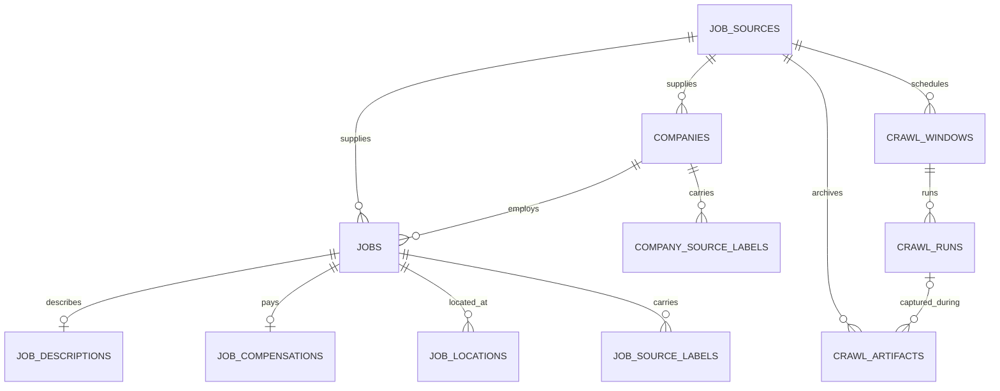

# Data Model: Nền tảng việc làm IT

Mô hình logic dùng PostgreSQL. Tên bảng có thể điều chỉnh trong migration nhưng các khóa, trạng thái, tính truy vết và quyền đọc công khai dưới đây là hợp đồng cần giữ.

## Quan hệ tổng quát

ERD này chỉ mô tả OLTP phục vụ website và quy trình crawl. Taxonomy chuẩn, phân tích kỹ năng và thống kê tổng hợp thuộc giai đoạn sau, không nằm trên đường ghi dữ liệu job.

## Website OLTP v1 — thiết kế theo JSON đã chốt

JSON xuất từ Saramin là dữ liệu staging, không đổ nguyên object vào một dòng OLTP. Website dùng khóa UUID nội bộ; ID của nguồn chỉ làm khóa đối chiếu. Thiết kế này không gộp công ty giữa các nguồn và không tạo bảng địa chỉ dùng chung: địa điểm được lưu theo từng job như cấu trúc đã duyệt.

### `companies` — hồ sơ công ty theo nguồn

| Cột | Kiểu PostgreSQL | Quy tắc |
|---|---|---|
| `company_id` | UUID PK | ID nội bộ, sinh riêng trong dự án. |
| `source_id` | UUID FK → `job_sources` | Nguồn cung cấp hồ sơ này. |
| `source_company_key` | TEXT NULL | ID công ty ở nguồn; không dùng làm PK nội bộ. Unique cùng `source_id` khi có giá trị. |
| `display_name` | TEXT NOT NULL | Tên công ty nguồn cung cấp. |
| `logo_url`, `cover_image_url` | TEXT NULL | Lưu URL, không tải và nhân bản ảnh trong MVP. |
| `source_slug`, `source_url`, `tagline` | TEXT NULL | Thông tin trang hồ sơ công ty tại nguồn. |
| `company_size_label` | TEXT NULL | Nhãn quy mô nguồn cung cấp. |
| `num_job_openings`, `num_employees` | INTEGER NULL | Không âm; giữ NULL nếu nguồn không có số liệu. |
| `created_at`, `updated_at` | TIMESTAMPTZ | Thời gian nội bộ. |

Mỗi record trong bảng là hồ sơ theo một nguồn. Không tự gộp hai hồ sơ cùng tên giữa các website. Các nhãn công ty tùy chọn (`nationalities_str`, `skills_arr`, `industries_arr`) lưu trong `company_source_labels` dạng text; không lấy chúng làm kỹ năng yêu cầu của job.

### `jobs` — tin tuyển dụng và khóa nguồn

| Cột | Kiểu PostgreSQL | Quy tắc |
|---|---|---|
| `job_id` | UUID PK | ID nội bộ dùng trong website/API. |
| `source_id` | UUID FK → `job_sources` | Nguồn gốc job. |
| `source_job_key` | TEXT NOT NULL | ID job tại nguồn; UNIQUE cùng `source_id`, chống trùng khi crawl lại. |
| `company_id` | UUID NULL FK → `companies` | Hồ sơ công ty theo cùng nguồn. |
| `title` | TEXT NOT NULL | Tiêu đề hiển thị. |
| `project_track` | TEXT NOT NULL | Nhãn phục vụ phạm vi website hiện tại, ví dụ `data`; gán từ cấu hình collection đã duyệt, không tra taxonomy hay ID nguồn. |
| `source_url` | TEXT NOT NULL | URL chi tiết gốc, lấy từ `detail_url`. |
| `application_url`, `source_slug`, `source_status_label` | TEXT NULL | Link ứng tuyển nếu có; slug và nhãn trạng thái nguyên gốc nếu cần truy vết. |
| `work_mode` | TEXT | `onsite`, `remote`, `hybrid`, `unknown`; CHECK constraint. |
| `listing_status` | TEXT NOT NULL | `active`, `expired`, `removed`, `unknown`; là trạng thái chuẩn của dự án, không chỉ sao chép `status_display`. |
| `published_at`, `expires_at`, `refreshed_at` | TIMESTAMPTZ NULL | Parse ngày nguồn theo timezone đã cấu hình cho adapter. Không lưu chuỗi tương đối như “1 ngày trước”. |
| `first_seen_at`, `last_seen_at` | TIMESTAMPTZ NOT NULL | Theo dõi lần đầu/cuối hệ thống thấy job; không thay cho ngày đăng. |
| `created_at`, `updated_at` | TIMESTAMPTZ NOT NULL | Thời gian nội bộ. |

Natural key là `UNIQUE (source_id, source_job_key)`. Không xóa job chỉ vì một lần crawl không thấy; cập nhật trạng thái chỉ sau một lượt nguồn hoàn tất hợp lệ.

### `job_descriptions` — nội dung mô tả đầy đủ

Một dòng hiện hành cho mỗi job (`job_id` là PK/FK). Nội dung website dùng một trường `overview_text TEXT NULL` cho toàn bộ mô tả đã lọc thành text. Nếu artifact cũ đã chia mô tả thành `overview_text`, `responsibilities_text`, `requirements_text` và `benefits_text`, loader nối các phần có nội dung theo thứ tự đó, ngăn cách bằng dòng trống; không parse HTML hay phân loại lại nội dung.

- `fetch_status`: `not_requested`, `pending`, `complete`, `empty`, `unavailable`, `not_authorized`.
- `content_hash`, `fetched_at`, `source_modified_at`, `parser_version`, `permission_scope`, `updated_at` để truy vết và tránh ghi đè nội dung hợp lệ bằng kết quả rỗng/lỗi.

Các cột nullable `responsibilities_text`, `requirements_text`, `benefits_text` còn trong bootstrap schema cũ để tương thích, nhưng loader mới để NULL và public contract không trả chúng. Không lưu thêm một bản tổng hợp thứ hai. Không biến giá trị thiếu thành chuỗi rỗng. Chỉ hiển thị mô tả khi source được duyệt và `allowed_uses.display_description=true`.

### `job_compensations` — mức lương

Một dòng tùy chọn mỗi job, `job_id` là PK/FK: `min_amount NUMERIC(14,2) NULL`, `max_amount NUMERIC(14,2) NULL`, `currency_code CHAR(3) NULL`, `pay_period TEXT NULL`, `display_text TEXT NULL`, `is_negotiable BOOLEAN NULL`. CHECK: số tiền không âm và `max_amount >= min_amount` khi cả hai có giá trị. Ví dụ `salary.value = "Thương lượng"` được lưu ở `display_text`; các khoảng số được lưu vào min/max/currency/period. Chỉ công khai thông tin lương khi quyền nguồn cho phép.

### `job_locations` — địa điểm riêng của từng job

Một dòng cho mỗi phần tử trong `addresses[]`: `job_location_id UUID PK`, `job_id UUID FK`, `position SMALLINT`, `country_code CHAR(2) NULL`, `province_city TEXT NULL`, `district TEXT NULL`, `ward TEXT NULL`, `address_line TEXT NULL`; UNIQUE `(job_id, position)`. Không tạo `locations` dùng chung hay suy diễn địa chỉ thiếu. Job remote có thể không có dòng địa điểm; `work_mode` nằm ở `jobs`.

### Nhãn nguyên gốc từ nguồn

Không tạo taxonomy nội bộ hoặc ánh xạ nhãn ngay khi ingest. Chỉ giữ nhãn chữ mà JSON đã chốt cung cấp để website có thể hiển thị/lọc theo giá trị nguồn và để giai đoạn sau xử lý lại khi đã có yêu cầu cụ thể.

| Bảng | Cột cốt lõi | Vai trò |
|---|---|---|
| `job_source_labels` | `job_source_label_id UUID PK`, `job_id FK`, `source_field`, `label_type`, `label_text`, `position` | Lưu từng nhãn chữ nguyên gốc từ job; không có `skill_id`, `normalized_label` hay mapping taxonomy. UNIQUE `(job_id, source_field, position)`. |
| `company_source_labels` | `company_source_label_id UUID PK`, `company_id FK`, `source_field`, `label_type`, `label_text`, `position` | Lưu nhãn hồ sơ công ty; không chuyển thành danh mục kỹ năng/ngành chuẩn. UNIQUE `(company_id, source_field, position)`. |

`label_type` chỉ là loại dữ liệu để giao diện biết cách trình bày (`skill`, `seniority`, `employment_type`, `experience`, `feature` ở job; `skill`, `industry`, `nationality` ở company); đây không phải taxonomy phân cấp. `label_text` giữ cách viết của nguồn. `source_field` giữ xuất xứ như `skills_arr` hay `extra_skills`. Với mảng, mỗi item là một dòng và `position` giữ thứ tự gốc; với trường chuỗi đơn, dùng `position=0` và không tự tách chuỗi. Không lưu ID taxonomy nguồn (`skills_ids`, `industries_ids`, `job_levels_ids`, `contract_types_ids`). `skills_str` bị bỏ vì lặp lại `skills_arr`.

### Ánh xạ từ JSON staging đã chốt

| JSON | OLTP |
|---|---|
| job `id` | `jobs.source_job_key`; `job_id` được sinh riêng. |
| `company.id` | `companies.source_company_key`; `company_id` được sinh riêng. |
| `owned_id` | Không lưu riêng: trong 14 record hiện tại trùng `company.id`. |
| `title`, `detail_url`, `job_url`, `slug`, `status_display`, `work_mode` | `jobs` theo các cột tương ứng; `job_url` thành `application_url` khi có URL hợp lệ. |
| Phạm vi collection do pipeline chọn | `jobs.project_track`, ví dụ `data`; không lấy từ taxonomy ID của nguồn. |
| `published.datetime`, `expires.datetime`, `refreshed.datetime` | Các timestamp trên `jobs`; bỏ `since` vì là chuỗi tương đối thay đổi theo lần crawl. |
| `company.*` | `companies`; nhãn hồ sơ text vào `company_source_labels` nếu cần dùng. |
| `salary` | `job_compensations`. |
| `addresses[]` | Nhiều dòng `job_locations`, không gộp/canonicalize trước. |
| `skills_arr`, `extra_skills`, `level`, `job_levels_arr`, `contract_types_str`, `experiences_str`, `features[]` | `job_source_labels`, lưu text nguyên gốc kèm `source_field` và `label_type`; không map taxonomy. |
| `company.nationalities_str`, `company.skills_arr`, `company.industries_arr` | `company_source_labels`, lưu text nguyên gốc; không map taxonomy. |
| `overview_text`, `responsibilities_text`, `requirements_text`, `benefits_text` | Ghép theo thứ tự vào `job_descriptions.overview_text`; các cột tách cũ để NULL. |
| `skills_str` | Bỏ vì trùng với `skills_arr`. |
| taxonomy IDs của nguồn, cờ cá nhân/gói quảng bá | Bỏ khỏi OLTP theo JSON đã chốt. |

`is_content_image` chưa cần vào OLTP website v1 vì mô tả đang lưu text và không lưu ảnh nội dung. Các cờ trạng thái người xem, gói quảng bá và ID taxonomy nguồn đã bị loại khỏi JSON nên không có cột tương ứng. Bản crawl gốc và các JSON dẫn xuất được lưu riêng trong `crawl_artifacts`, không nhúng vào bảng `jobs` và không đưa vào public view.

`job_category_id` của nguồn cũng không được dùng. `project_track` chỉ là một nhãn lọc đơn giản trên bản ghi job (ví dụ `data`), đặt từ cấu hình collection/crawl window; không tạo bảng danh mục, cây phân cấp hay bảng mapping ở OLTP v1. Nếu một job cần thuộc nhiều track hoặc cần phân loại tự động, bổ sung thiết kế khi có yêu cầu vận hành cụ thể.

### Read model và quyền truy cập Supabase

- Website đọc qua `public_job_cards` (danh sách/phân trang) và `public_job_detail` (chi tiết), không cấp SELECT trực tiếp các bảng nền cho role anon.
- View chỉ trả job có nguồn `permission_status='approved'` và được phép `display_metadata`; phần mô tả chỉ được trả khi thêm quyền `display_description`.
- `crawl_windows`, `crawl_runs`, nhãn nội bộ chưa duyệt và dữ liệu nguồn hạn chế không được đưa vào public view.
- MVP hiện là website đọc job và phân tích; chưa tạo bảng `users`, `applications`, `saved_jobs` vì đăng nhập/ứng tuyển/lưu job chưa thuộc phạm vi.

## Thực thể

### `job_sources` — nguồn việc làm

| Trường | Kiểu logic | Quy tắc |
|---|---|---|
| `source_id` | UUID/PK | Định danh nội bộ ổn định; không dùng tên hiển thị làm khóa. |
| `code` | text/unique | Mã ổn định, ví dụ `topdev`; không đổi khi đổi thương hiệu. |
| `display_name` | text | Tên dùng trên website. |
| `base_url` | text | Host gốc đã xác minh; được phép thay đổi có ghi nhận. |
| `permission_status` | enum | `pending_review`, `approved`, `blocked`, `revoked`; mặc định `pending_review`. |
| `allowed_uses` | JSON/flags | Phạm vi đã xác minh riêng cho crawl, lưu metadata, lưu JD, phân tích, hiển thị metadata và hiển thị JD. Không mặc định quyền nào từ quyền khác. |
| `terms_url`, `robots_checked_at`, `permission_evidence_ref` | text/timestamp | Lưu bằng chứng/đường dẫn và thời điểm xác minh, không coi robots là giấy phép nội dung. |
| `min_delay_seconds`, `max_concurrency` | numeric/integer | Chính sách riêng nguồn; concurrency không vượt 1 theo baseline ban đầu. |
| `adapter_version`, `enabled` | text/boolean | Adapter chỉ chạy khi `enabled=true`, quyền cần thiết được duyệt và cấu hình còn hiệu lực. |

### `crawl_windows` — khoảng lịch sử cần xử lý

| Trường | Kiểu logic | Quy tắc |
|---|---|---|
| `window_id` | UUID/PK | Định danh một yêu cầu backfill. |
| `source_id` | FK | Nguồn duy nhất cho cửa sổ này. |
| `requested_from`, `requested_to` | date/timestamp | Cận khoảng theo múi giờ/ý nghĩa ngày đã chuẩn hóa; lưu rõ inclusive/exclusive trong adapter contract. |
| `status` | enum | `pending`, `running`, `complete`, `empty`, `paused`, `failed`. |
| `cursor` | JSON nullable | Token/page/date tiếp theo để tiếp tục; không chứa secret. |
| `items_seen`, `jobs_inserted`, `jobs_updated`, `details_fetched` | integer | Bộ đếm tích lũy, không dùng số dòng thay đổi DB làm số job duy nhất. |
| `last_error_stage`, `last_error_code`, `last_error_at` | nullable | Phân biệt request, parse, detail, transform và DB. Không lưu credential hay toàn bộ response nhạy cảm. |
| `created_at`, `updated_at`, `finished_at` | timestamp | Thời điểm trạng thái được đổi. |

### `crawl_artifacts` — lưu bản crawl gốc và JSON dẫn xuất

Mỗi file HTML, JSON hoặc JSON Lines được lưu thành một artifact, gắn với nguồn và tùy chọn với `crawl_run`. Bảng này phục vụ lưu trữ/truy vết, không thay thế các bảng job OLTP và không được public.

| Cột | Kiểu PostgreSQL | Quy tắc |
|---|---|---|
| `artifact_id` | UUID PK | ID nội bộ. |
| `source_id`, `crawl_run_id` | UUID FK; run nullable | Nguồn bắt buộc; artifact từ lượt crawl cũ có thể chưa có `crawl_run_id`. |
| `artifact_kind`, `file_name`, `source_url`, `artifact_date` | TEXT/TEXT/TEXT/DATE | Loại artifact, tên file, URL nguồn và ngày của snapshot. |
| `content_type` | TEXT | `text/html`, `application/json`, hoặc `application/x-ndjson`. |
| `content_text` | TEXT NOT NULL | Nội dung UTF-8 nguyên văn để giữ bản gốc. |
| `content_json` | JSONB NULL | JSON đã parse; JSON Lines được lưu thành mảng JSONB. NULL với HTML. |
| `content_sha256`, `created_at` | CHAR(64), TIMESTAMPTZ | Kiểm tra toàn vẹn và thời điểm lưu. |

Unique `(source_id, file_name, content_sha256)` cho phép chạy lại import mà không nhân bản cùng một artifact; nội dung thay đổi tạo phiên bản có hash mới. JSONB chuẩn hóa cách biểu diễn JSON, vì vậy `content_text` được giữ cùng để bảo toàn bản file gốc.

Ràng buộc: unique theo `(source_id, requested_from, requested_to)` cho yêu cầu cùng cửa sổ; lặp lại phải resume/reconcile cửa sổ hiện tại, không tạo lịch sử mơ hồ. `paused` giữ cursor để tiếp tục. `empty` chỉ hợp lệ sau khi nguồn phản hồi bình thường và toàn bộ cửa sổ đã kiểm tra.

### `job_ingest_candidates` — JSON trung gian chờ xác minh/nạp

Mỗi dòng giữ nguyên một record JSON lấy từ `crawl_artifacts`, trước khi ghi hoặc cập nhật OLTP website. Bảng này giữ dữ liệu chưa đạt kiểm tra để có thể xem lại; chỉ candidate `verified` mới được áp dụng. Đây là bảng nội bộ ingestion, không cấp quyền cho role website.

| Cột | Kiểu PostgreSQL | Quy tắc |
|---|---|---|
| `candidate_id` | UUID PK | ID nội bộ của candidate. |
| `artifact_id`, `source_id` | UUID FK | Artifact đầu vào và nguồn đã cấu hình. |
| `record_index`, `source_job_key`, `project_track` | INTEGER/TEXT/TEXT | Vị trí trong artifact, ID nguồn nếu có, và track dự kiến. Unique `(artifact_id, record_index)`. |
| `candidate_json` | JSONB NOT NULL | Toàn bộ record JSON chưa chuẩn hóa; kể cả record sai kiểu vẫn được giữ để rà soát. |
| `verification_status` | TEXT | `verified`, `needs_review`, `rejected`; lỗi kiểm tra là `rejected`, cảnh báo là `needs_review`. |
| `validation_errors`, `validation_warnings` | JSONB array | Lý do kiểm tra tự động, không thay cho quyết định xác minh thủ công. |
| `validator_version`, `checked_at` | TEXT/TIMESTAMPTZ | Phiên bản và thời điểm chạy kiểm tra. |
| `load_status`, `job_id`, `loaded_at` | TEXT/UUID/TIMESTAMPTZ | `pending` hoặc `loaded`; liên kết tới job sau khi `--apply` thành công. |
| `created_at`, `updated_at` | TIMESTAMPTZ | Thời gian quản lý candidate. |

`--dry-run` chỉ báo cáo; `--verify` ghi candidate vào bảng này; `--apply` chỉ ghi candidate `verified` còn `pending`. Cả ghi job và cập nhật `load_status` nằm trong một transaction. Candidate có cảnh báo/lỗi vẫn được giữ lại và không public.

### `crawl_runs` — lần thực thi

Mỗi lần thử xử lý một cửa sổ có một `run_id`, `window_id`, `started_at`, `finished_at`, `trigger` (`manual`, `schedule`, `retry`), `status`, bộ đếm delta của lần chạy, `http_429_count`, `blocked_count`, `error_stage` và `error_code`. Một window có thể có nhiều run; run lịch sử bất biến để audit. Secret, cookie, authorization header và raw HTML không ghi vào log.

### `jobs` — tin tuyển dụng chuẩn hóa

Schema website chi tiết nằm ở mục **Website OLTP v1** ở trên. `job_id` là UUID nội bộ; natural key là `(source_id, source_job_key)`. Không gộp job giữa các nguồn chỉ vì trùng URL hoặc tiêu đề.

### `job_descriptions` — mô tả công việc

Schema website hiện dùng `overview_text` (nullable) cho toàn bộ mô tả trong một dòng hiện hành theo job. Các cột tách cũ còn trong bootstrap schema nhưng không được điền hoặc public. Không lưu thêm bản tổng hợp `content_text`. Có thể bổ sung bảng version riêng khi có quyền và nhu cầu lịch sử; lần tải rỗng/lỗi không được ghi đè phần mô tả hợp lệ trước đó.

Nội dung mô tả và trích đoạn kỹ năng là dữ liệu có quyền nguồn riêng. Chỉ đưa vào public read surface khi `allowed_uses.display_description=true` và source vẫn `approved`.

## OLAP warehouse — DuckDB container riêng

Warehouse OLAP được tạo bởi `database/olap/migrations/001_warehouse_core.sql` trong schema `warehouse`; PostgreSQL OLTP vẫn là nguồn dữ liệu chuẩn cho website. File DuckDB được giữ trong Docker named volume `it_job_olap_data`. Không đưa `candidate_json`, HTML hoặc toàn bộ JD vào warehouse.

| Bảng | Grain / mục đích | Trường cốt lõi |
|---|---|---|
| `dim_date` | Một ngày lịch | `date_key`, `full_date`, `calendar_year`, `calendar_quarter`, `calendar_month`, `month_start`, `iso_week`, `day_of_month`, `day_of_week`. |
| `dim_source` | Một nguồn việc làm | `source_key`, `source_id`, `source_code`, `display_name`, `base_url`. |
| `dim_company` | Hồ sơ công ty theo nguồn | `company_key`, `source_key`, `source_company_key`, `company_name`, `company_size_label`. Không tự gộp công ty khác nguồn. |
| `dim_location` | Một địa điểm thực sự được nguồn cung cấp | `location_key`, `location_hash`, `country_code`, `province_city`, `district`, `ward`, `address_line`. Không có hàng giả cho remote/unknown. |
| `dim_job` | Một job theo khóa tự nhiên của nguồn | `job_key`, `source_key`, `source_job_key`, `title`, `project_track`, `source_url`, `work_mode`, `listing_status`, `description_hash`, `first_seen_at`, `last_seen_at`, `is_current`. |
| `dim_seniority` | Nhãn cấp độ theo nguồn và phiên bản mapping | `seniority_key`, `source_key`, `source_label`, `normalized_level`, `mapping_version`, `is_unknown`. |
| `dim_skill`, `dim_skill_alias` | Taxonomy/alias có version | `skill_key`, `canonical_name`, `category`, `taxonomy_version`, `is_active`; alias có `skill_alias_key`, `skill_key`, `alias_text`, `normalized_alias`, `language_code`, `taxonomy_version`. |
| `dim_analyzer_version` | Cấu hình một analyzer | `analyzer_key`, `analyzer_name`, `analyzer_version`, `taxonomy_version`, `method`, `config_hash`, `created_at`. |
| `bridge_job_location` | Một địa điểm được gắn cho job | `(job_key, position)`, `location_key`. Một job có thể có 0..N dòng; không có dòng nghĩa là nguồn không cung cấp địa điểm. |
| `bridge_job_source_label` | Một nhãn chữ nguyên gốc của job | `(job_key, source_field, position)`, `label_type`, `label_text`. |
| `fact_job_posting` | Một dòng cho mỗi job hiện hành | `job_key`, `source_key`, `published_date_key`, `expires_date_key`, `company_key`, `seniority_key`, `work_mode`, `salary_min`, `salary_max`, `salary_currency`, `salary_period`, `job_count`. Không có `location_key`; xem địa điểm qua bridge. |
| `fact_job_analysis` | Một lần phân tích theo job, hash JD và analyzer | `analysis_key`, `job_key`, `analyzer_key`, `analyzed_date_key`, `description_hash`, `analysis_status`, `skill_count`, `error_code`, `created_at`. |
| `fact_job_skill` | Một kỹ năng trong một lần phân tích | `analysis_key`, `skill_key`, `max_confidence`, `evidence_count`, `job_skill_count`. |
| `fact_job_skill_evidence` | Một bằng chứng phát hiện kỹ năng | `evidence_key`, `analysis_key`, `skill_key`, `evidence_position`, `start_offset`, `end_offset`, `excerpt`, `confidence`, `match_method`. Excerpt chỉ lưu nếu quyền cho phép. |
| `fact_crawl_run` | Một lần chạy crawl | `crawl_run_key`, `source_key`, `window_start`, `window_end`, `started_at`, `finished_at`, `run_status`, `pages_seen`, `jobs_seen`, các bộ đếm staged/verified/review/rejected và HTTP 429. |
| `mart_skill_demand_monthly` | Một nhóm tháng/nguồn/track/địa điểm/work mode/cấp độ/kỹ năng | `month_key`, dimension keys, `total_job_count`, `eligible_job_count`, `analyzed_job_count`, `skill_job_count`, `skill_share`, `analysis_coverage`, `generated_at`. |
| `mart_source_coverage_monthly` | Coverage tháng theo nguồn/track | `month_key`, `source_key`, `project_track`, `total_job_count`, `jobs_with_location`, `jobs_without_location`, `remote_without_location`, `latest_published_date`, `generated_at`. |

`fact_job_posting` giữ một dòng/job; lọc và thống kê theo địa điểm đi qua `bridge_job_location` và phải đếm `COUNT(DISTINCT job_key)` vì một job có thể có nhiều địa điểm. Remote vẫn là `work_mode='remote'`; job không có địa điểm có 0 bridge rows. Không được tự gán job thiếu địa chỉ thành remote.

Các mart dùng mẫu số tường minh: `skill_share = skill_job_count / analyzed_job_count`; `analysis_coverage = analyzed_job_count / eligible_job_count`. Khi export từ OLTP, chỉ lấy job/dữ liệu mô tả có phạm vi quyền tương ứng. Mọi DDL OLAP chạy qua migration riêng, không qua từng lượt ETL.

## Trạng thái và quy tắc chuyển

- Crawl window: `pending → running → complete|empty|paused|failed`; `paused → running` khi resume. `empty` khác `failed` và cần phản hồi nguồn bình thường.
- Listing: `active → expired|removed|unknown` chỉ sau khi có dữ liệu crawl đủ tin cậy; một lần không thấy job không đủ để xóa hoặc đánh dấu removed.
- Description: `not_requested → pending → complete|empty|unavailable|not_authorized`. Lỗi detail không làm mất listing hay mô tả hợp lệ trước đó.
- Skill analysis: `pending → complete|skipped|failed`; chỉ `complete` có thể góp vào thống kê.
- Source permission: chỉ `approved` với đủ flags mới bật adapter/public views; khi `revoked` hoặc `blocked`, dừng thu thập và ẩn dữ liệu khỏi public view theo chính sách đã duyệt.

## Migration và chỉ mục

- Schema thay đổi qua file migration SQL có số phiên bản và ghi vào `schema_migrations` đúng một lần; chạy qua lệnh migration/operator trước ingest.
- Loại bỏ việc chạy DDL từ mỗi transform/`ensure_tables()`; pipeline worker chỉ đọc schema/version và báo lỗi rõ nếu migration chưa áp dụng.
- Indexes tối thiểu: unique `(source_id, source_job_key)`; `(listing_status, published_at DESC)`; `companies(source_id, source_company_key)`; `job_locations(province_city, district)`; `job_source_labels(job_id, label_type)` và chỉ mục ngược theo `(label_type, label_text)` nếu UI cần lọc nhãn; `company_source_labels(company_id, label_type)`; các khóa nguồn/cửa sổ crawl.
- Bổ sung full-text index hoặc trigram chỉ khi truy vấn website thực tế cần đến; không index toàn bộ mô tả dài mặc định trên quota Free.
- Public API chỉ được cấp SELECT/EXECUTE trên public views/RPC; role ingestion có quyền tối thiểu cần để ghi job, trạng thái và kết quả nhưng không có quyền quản trị schema.
